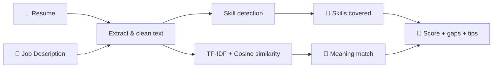

# 🎯 Resume JD Matcher

 > Am I ready for this job? Get your answer in 10 seconds.

Built for **freshers and first-time job seekers**. Upload your resume, paste a job description, and see where you stand *before* you apply.

🔗 **[Live Demo](#)**

## What you see after one click

For a Backend Intern JD, my own resume got:

| | Result |
|---|---|
| 🎯 Match score | **40 / 100** (Low match) |
| ✅ Found | Python, SQL, Git, AWS |
| ❌ Missing | Docker, FastAPI, REST API |
| 🚀 Next step | "FastAPI: build a small API with 2 endpoints and add it to your resume" |

Not just a score, but a to-do list.

## How it works

## Features

- 🧩 Clickable Found / Missing skill boxes with glass popups
- 📊 Gaps grouped by Languages, Frameworks, Databases, Tools & Cloud, Concepts
- 🧠 "Why this score?" explained in plain language
- 🚀 A tip for every missing skill
- 🌙 Dark and light theme

## What I learned building this

- My first version used `sentence-transformers`, but it was too heavy for free hosting (the project crossed 5 GB with `venv` and `node_modules`).
- I replaced it with **TF-IDF + cosine similarity**, which is lightweight and runs on a 512 MB server.
- Splitting React code into small components made adding new sections easy.

live demo :https://matchresume-delta.vercel.app/
Open `http://localhost:5173`

---

Built by **Jiya Shah** · Computer Engineering student
