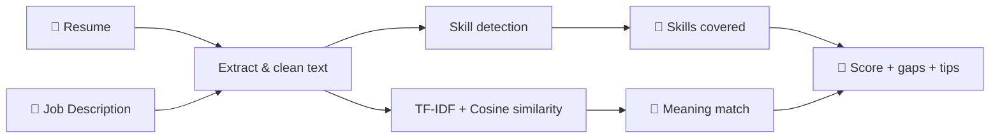

# 🎯 Resume JD Matcher

> Am I ready for this job? Get your answer in seconds.

Built for **freshers and first-time job seekers**. Upload your resume, paste a job description, and see where you stand *before* you apply.

🔗 **[Live Demo](https://matchresume-delta.vercel.app/)**

## Features

- 🎯 Match score out of 100 (meaning match + skills covered)
- 🧩 Clickable Found / Missing skill boxes with glass popups
- 📊 Gaps grouped by Languages, Frameworks, Databases, Tools & Cloud, Concepts
- 🧠 "Why this score?" explained in plain language
- 🚀 A tip for every missing skill
- 🌙 Dark and light theme

## How it works

## What I learned building this

- My first version used `sentence-transformers`, but it was too heavy for free hosting.
- I replaced it with **TF-IDF + cosine similarity**, which is lightweight and runs on a 512 MB server.
- Splitting React code into small components made adding new sections easy.

---

Built by **Jiya Shah** · Computer Engineering student
